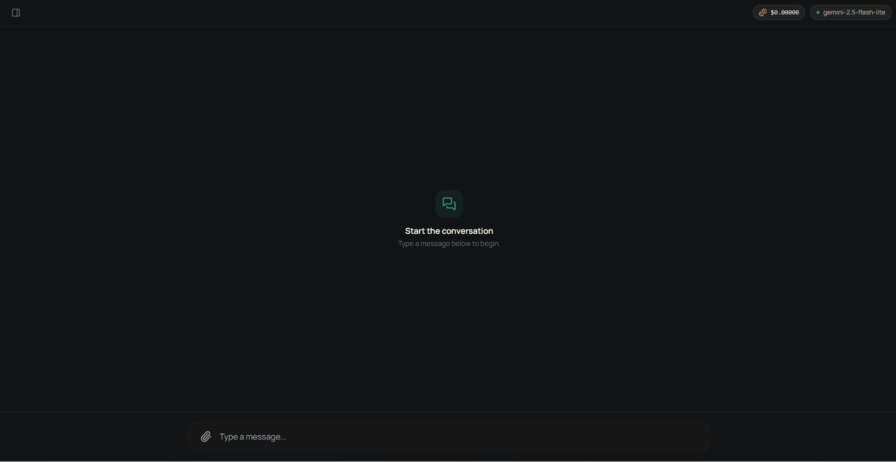

# Agentic-Chatbot

Hello there! 😀

This project is an **Agentic Chatbot** built using **LangChain**, **LangGraph**, and **FastAPI**, with **PostgreSQL**
as the core data layer for semantic vector search, long-term memory, and
conversation state persistence.

Here’s a quick demo of the chatbot in action:

<p align="center">
  
</p>

The application is structured to be cloud-agnostic and modular: it can run fully in a local development environment, or
be deployed to **Google Cloud Platform (GCP)** and **Amazon Web Services (AWS)**.

The core system coordinates agents through state graphs (LangGraph), allowing:

- Dynamic tool-calling decisions.
- Multi-modal capabilities.
- Vector retrieval and similarity ranking stored natively inside PostgreSQL with `pgvector`.
- High-throughput asynchronous endpoints powered by FastAPI.

The purpose of the application is mainly to provide a prototype and a tutorial for implementing a simple web
application.

## Installation

This project requires **Python 3.14** and relies strictly on [Poetry](https://python-poetry.org/) for modern packaging
and deterministic dependency resolution.

### Application

In order to isolate the dependencies based on the desired setup, we offer different ways of configuring the project
dependencies.

#### Local

Installs the core libraries (e.g. FastAPI, LangChain, LangGraph, etc.) alongside the LangChain Ollama implementation for
running models locally. This setup is useful for a fully local environment, with no need to connect to any cloud
service, not even for API calls to LLM or embeddings models. To install, run the following command:

```bash
poetry install --extras "local"
```

As a side note, depending on the chosen model, this setup requires a local machine with good computing power,
preferably with a GPU. For example, with an NVIDIA RTX 5060 8GB, the `qwen2.5:7b` model works great, while the
`gemma4:12b` model already struggles a bit.

To get these models, first follow the Ollama documentation to download them locally: https://ollama.com/download.

#### GCP

Installs the core libraries alongside Google Cloud client packages. This setup is certainly useful for testing a
possible future deployment on GCP, but it is also useful for simply making API calls to Google's Gemini models. As we
will see later, we can use this feature while still relying on a fully local database service. To install, run the
following command:

```bash
poetry install --extras "gcp"
```

To use this setup, you need to have created a GCP project with an active billing account (or within the free trial
period).

#### AWS

Installs the core libraries alongside AWS SDKs. This setup is certainly useful for testing a possible future
deployment on AWS, but it is also useful for simply making API calls to Amazon's Nova models. As we will see later, we
can use this feature while still relying on a fully local database service. To install, run the following command:

```bash
poetry install --extras "aws"
```

To use this setup, you need to have created an AWS account with an active billing account (or within the free trial
period).

#### All

Installs every module across local, GCP, and AWS environments. Useful for monolithic test environments or central
workstations. To install, run the following command:

```bash
poetry install --extras "all"
```

### Database

To run database capabilities locally, make sure to have a running PostgreSQL instance
(https://www.postgresql.org/download/), which will have you create a default `postgres` user with its password.
This local instance is obviously needed for the local setup, but also for connecting to cloud databases, such as Cloud
SQL on GCP and RDS on AWS.
Indeed, once these cloud resources are created, they can also be used, tested, and monitored locally through suitable
connections, which we will see later for each provider.

## Local Deployment

### Database

Using any graphical client (e.g. DBeaver) for the local configuration, we create a connection to PostgreSQL on port
5432 and create a database:

```sql
CREATE DATABASE chatbot;
```

Connect to the database and enable the `pgvector` vector extension:

```sql
CREATE EXTENSION IF NOT EXISTS vector;
```

This extension is mandatory: it adds native vector similarity data types and distance operators (`<->`, `<#>`, `<=>`).

### Storage

For a fully local setup, object storage is provided by [SeaweedFS](https://github.com/seaweedfs/seaweedfs), which
exposes an S3-compatible API and runs as a single executable.

- Download the release for your operating system from the
  [official releases page](https://github.com/seaweedfs/seaweedfs/releases) and extract the `weed` executable (e.g.,
  `weed.exe`) into a folder of your choice (e.g., `C:\seaweedfs`).
- Add that folder to your system `PATH`.
- Create a folder where the data will be stored:

```powershell
  mkdir C:\seaweedfs-data
```

- Start SeaweedFS with the S3 module enabled:

```powershell
  weed server -s3 -dir="C:\seaweedfs-data"
```

  (Keep this terminal window running as long as you need the storage active.)

Once started, the following services are available:

- **Filer (file browser)**: http://localhost:8888, where you can browse, download and view the stored objects
  (buckets are under `/buckets`).
- **Master (cluster status)**: http://localhost:9333, to check volumes and disk space.
- **S3 API**: http://localhost:8333.

Finally, create the bucket manually (e.g., `chatbot`) and set its name in the `STORAGE_BUCKET` environment variable.

### Environment

To run the code locally once the desired installation steps are completed, you need to configure the environment
variables in a dedicated `.env` file, depending on the chosen setup. 

Suppose we want to test a fully local configuration. On local, all we have to do is create a storage bucket called 
`your_bucket_name` from the *seaweedfs* console. In this case, one way of populating the variables could be the 
following:

```
STORAGE_BUCKET=your_bucket_name
SECRET_KEY=your_super_secret_jwt_or_app_key
COOKIE_SECURE=False
LLM_MODEL=qwen2.5:7b
EMBEDDINGS_MODEL=bge-m3:latest
DB_USER=postgres
DB_PASSWORD=your_secure_password
DB_NAME=chatbot
DB_HOST=localhost
DB_PORT=5432
```

Suppose we want to test the configuration on GCP while relying on a fully local database. On GCP, all we have done is
create the project and a storage bucket called `your_bucket_name` from the GCP Console. In this case, one way of
populating the variables could be the following:

```
CLOUD_PROVIDER=gcp
STORAGE_BUCKET=your_bucket_name
SECRET_KEY=your_super_secret_jwt_or_app_key
COOKIE_SECURE=False
LLM_MODEL=gemini-2.5-flash-lite
EMBEDDINGS_MODEL=models/gemini-embedding-001
DB_USER=postgres
DB_PASSWORD=your_secure_password
DB_NAME=chatbot
DB_HOST=localhost
DB_PORT=5432
```

If we wanted to do the equivalent with AWS, it is enough to create a bucket on S3:

```
STORAGE_BUCKET=your_bucket_name
SECRET_KEY=your_super_secret_jwt_or_app_key
COOKIE_SECURE=False
LLM_MODEL=amazon.nova-lite-v1:0
EMBEDDINGS_MODEL=amazon.titan-embed-text-v2:0
DB_USER=postgres
DB_PASSWORD=your_secure_password
DB_NAME=chatbot
DB_HOST=localhost
DB_PORT=5432
```

We can then run the application locally. Activate the virtual environment and run the Uvicorn ASGI server with
live reload enabled:

```bash
uvicorn chatbot.main:app --port 8000 --env-file .env --reload
```

The application will listen on http://localhost:8000.

## Docker Deployment

To dockerize the application into a Docker image, we use Docker Compose to manage the database and the application
together. Dockerization is supported only for the GCP setup:

- Create a `.secrets` folder.
- Copy the `application_default_credentials.json` file you have in
  `%APPDATA%\gcloud\application_default_credentials.json` (or the JSON key of your Service Account) into the newly
  created folder.

Use the following command to build and start the containers:

**Linux / macOS**

```bash
ENV_FILE=.env docker compose up --build
```

**Windows (PowerShell)**

```powershell
$env:ENV_FILE=".env"; docker compose up --build
```

Use the GCP `.env` configuration and add a `GOOGLE_CLOUD_PROJECT` environment variable pointing to the desired GCP
project whose credentials you have also passed.
This will automatically launch the application, which will be available at http://localhost:8000.

> [!WARNING]
> Mounting your personal Application Default Credentials into the container is fine for local development, but it
> must **not** be done in production. There, rely on a dedicated Service Account attached to the runtime (e.g. Cloud
> Run). Also make sure `.secrets/` and `.env` are listed in your `.gitignore`, so that credentials are never committed.

## Google Cloud Platform (GCP) Deployment

An active Google Cloud Platform project with billing enabled and sufficient IAM permissions (e.g., `Owner` or `Editor`).

Throughout this guide, `<PROJECT_ID>` refers to your GCP project and `<REGION>` to its main region (e.g., `europe-west1`).

> [!NOTE]
> Before launching resources on Google Cloud, you can estimate the monthly operating costs using the official
> [Google Cloud Pricing Calculator](https://cloud.google.com/products/calculator?hl=en).

> [!IMPORTANT]
> The entire cloud infrastructure described below has been defined and automated using **Terraform**. The complete
> Infrastructure as Code (IaC) configuration is available in the following repository:
> [pietro-foini/terraform-gcp](https://github.com/pietro-foini/terraform-gcp).

While Terraform provisions the resources deterministically, the sections below explain how each service is structured,
how the pieces fit together, and how you can manage or inspect them manually.

### Cloud SQL Setup

On GCP, the relational database layer is managed by Cloud SQL for PostgreSQL.

- Navigate to Cloud SQL in the GCP Console.
- Click Create Instance, choose PostgreSQL, and specify an Instance ID (e.g., `postgres`), an admin password for the
  default `postgres` user, and your target region. Resource Tier: choose the machine size that fits your budget. 
  For testing, the smallest available tier is enough.
- Open Cloud SQL Studio in the browser, log in with the `postgres` user, and create the production database:

  ```sql
  CREATE DATABASE chatbot;
  ```

- Connect to the `chatbot` database and activate the vector extension:

  ```sql
  CREATE EXTENSION IF NOT EXISTS vector;
  ```

Now that we have created the resource, we can use it locally, for example, through the **Cloud SQL Auth Proxy**.

#### How does it work?

The proxy runs locally and simulates a local PostgreSQL database on your machine. It listens on a local port (e.g.,
`127.0.0.1:5434`).
When your local application or database UI sends packets to `127.0.0.1:5434`, the proxy encrypts the traffic using TLS
with your GCP IAM credentials and routes it securely through Google's internal APIs directly to your Cloud SQL
instance. Your local Python code does not need to know where the database physically lives: it simply connects to
`localhost`.

#### Setup Steps

- Download the `cloud-sql-proxy` executable for your operating system
  (https://docs.cloud.google.com/sql/docs/mysql/sql-proxy). Place the binary into a persistent folder on your machine
  and add that folder to your system `PATH`.
- Start the proxy from your terminal:

  ```bash
  cloud-sql-proxy <PROJECT_ID>:<REGION>:postgres --port 5434
  ```

  (Keep this terminal window running as long as you need the connection active.)

You can now connect your local GUI (DBeaver) or run migration scripts by targeting host `127.0.0.1`, port `5434`, user
`postgres`, and your set password.

For this configuration, i.e. running locally with a connection to Cloud SQL, it is enough to set these environment
variables:

```
CLOUD_PROVIDER=gcp
STORAGE_BUCKET=your_bucket_name
SECRET_KEY=your_super_secret_jwt_or_app_key
COOKIE_SECURE=False
LLM_MODEL=gemini-2.5-flash-lite
EMBEDDINGS_MODEL=models/gemini-embedding-001
DB_USER=postgres
DB_PASSWORD=your_secure_password
DB_NAME=chatbot
DB_HOST=127.0.0.1
DB_PORT=5434
```

### Cloud Run

Create a serverless service that runs the container on which our actual application live.

- Navigate to Cloud Run Services in the GCP Console.
- Create service:
  - Deploy one revision from an existing container image.
  - Select a demo image: `hello`.
  - Define the name `chatbot-service` and the region `<REGION>`.
  - Under Containers, Networking, Security, select Cloud SQL connections and specify the connection (e.g.,
    `<PROJECT_ID>:<REGION>:postgres`). Cloud Run automatically mounts a Unix socket at
    `/cloudsql/<INSTANCE_CONNECTION_NAME>`, giving your container secure, high-speed access to PostgreSQL without public
    routing.

### Artifact Registry

On GCP, Docker images are stored in the Artifact Registry resource.

- Navigate to Artifact Registry in the GCP Console.
- Create a Docker repository (e.g., `ml-servers`) inside your chosen region (e.g., `<REGION>`) to host the
  production container images built for Cloud Run.

### Secret Manager

On GCP, secret variables that should not be exposed are managed by the Secret Manager service.

- Navigate to Secret Manager in the GCP Console.
- Create three separate secret keys in GCP Secret Manager:
  - `postgres_db_password`
  - `postgres_db_username`
  - `auth_key`
- Populate them.

These variables will be used and configured to the Cloud Run during deployment (see next step and the file `cloud/gcp/cloudbuild.yaml`).

### Cloud Build

The deployment pipeline is fully automated via Cloud Build:

- Connect your GitHub repository to GCP using the Developer Connect API.
- Navigate to IAM & Admin and verify that the Cloud Build Service Account (or dedicated worker account) possesses the
  necessary IAM roles:
  - Agent Platform User
  - Artifact Registry Writer
  - Cloud Build Service Account
  - Cloud Run Admin
  - Cloud SQL Client
  - Developer Connect Read Token Accessor (Beta)
  - Logs Writer
  - Secret Manager Secret Accessor
  - Service Account User
  - Storage Object User
- Create a Cloud Build Trigger:
  - Link the trigger to the connected GitHub repository.
  - Set the event to push on your target branch (e.g., `master`).
  - Define the required Substitution Variables, for example:
    - `_STORAGE_BUCKET`
    - `_COOKIE_SECURE`
    - `_LLM_MODEL`
    - `_EMBEDDINGS_MODEL`
    - `_DB_NAME`
    - `_INSTANCE_CONNECTION_NAME`

The build process reads `cloud/gcp/cloudbuild.yaml`, builds the container, pushes it to Artifact Registry, and deploys
a new revision directly to Cloud Run. The service outputs a secure HTTPS URL where the application is live.

## Amazon Web Services (AWS) Deployment

An active Amazon Web Services account with billing enabled and sufficient IAM permissions (e.g., `AdministratorAccess`
or equivalent).

Throughout this guide, `<ACCOUNT_ID>` refers to your 12-digit AWS account ID and `<REGION>` to your target region
(e.g., `eu-north-1`).

> [!NOTE]
> Before launching resources on AWS, you can estimate the monthly operating costs using the official
> [AWS Pricing Calculator](https://calculator.aws/).

> [!IMPORTANT]
> The entire cloud infrastructure described below has been defined and automated using **Terraform**. The complete
> Infrastructure as Code (IaC) configuration is available in the following repository:
> [pietro-foini/terraform-aws](https://github.com/pietro-foini/terraform-aws).

While Terraform provisions the resources deterministically, the sections below explain how each service is structured,
how the pieces fit together, and how you can manage or inspect them manually.

### Network Setup (VPC and Security Group)

Every AWS region comes with a **default VPC** (Virtual Private Cloud): a ready-to-use virtual network that already has
one public subnet per Availability Zone and an Internet Gateway attached. For this project we simply reuse it, so there
is no need to create subnets, route tables or gateways. Both the RDS database and the EC2 instance will live in this
VPC, which lets them talk to each other over the internal network.

What we do create is a dedicated **security group** for the database. A security group is a stateful firewall attached
to a resource: only traffic matching one of its inbound rules can reach it. Creating a new one, instead of editing the
`default` security group shared by every resource in the VPC, keeps the project rules isolated and easy to audit.

Let's then create a security group for the RDS database:

- Navigate to VPC > Security groups (or EC2 > Security Groups) and click Create security group.
- Name: `ml-rds-sg`, description: `Inbound rules for RDS PostgreSQL`, VPC: the default VPC.
- Inbound rules, add:
  - Type: `PostgreSQL` (port `5432`)
  - Source: `My IP`, or `0.0.0.0/0` during initial development.
- Outbound rules: keep the default `All traffic` towards `0.0.0.0/0`.
- Click Create security group.

The security group of the application (EC2) will be created later in the same VPC, and the RDS group will be updated to
accept traffic from it.

### Amazon RDS Setup

On AWS, the relational database layer (the equivalent of GCP Cloud SQL) is managed by Amazon RDS for PostgreSQL.

- Navigate to RDS > Databases in the AWS Management Console.
- Click Create database, choose Standard create and select the PostgreSQL engine.
- Under Templates, select Free tier or Dev/Test.
- Configure the settings:
  - DB instance identifier: `postgres`
  - Master username: `postgres`
  - Master password: choose a strong password.
  - Instance class: choose the size that fits your budget. For testing, a burstable class such as `db.t4g.micro`
    (2 vCPUs, 1 GiB RAM, about 0.019 USD/hour) is enough.
  - Storage: 20 GiB.
- Under Connectivity:
  - Virtual private cloud (VPC): the default VPC.
  - DB subnet group: `default`.
  - Set Public access to `Yes` (by default the database is created as private). This is needed to reach it from your
    local machine.
  - VPC security group: choose existing and select `ml-rds-sg`.

> [!NOTE]
> Unlike GCP Cloud SQL Studio, AWS RDS does not provide an in-browser query editor. You need an external client such as
> DBeaver, pgAdmin or the PostgreSQL extension for VS Code.

#### How does it work?

An RDS instance is reachable through a public endpoint (e.g., `chatbot.xxxxxx.<REGION>.rds.amazonaws.com`) on port
`5432`. Unlike Cloud SQL, there is no proxy: access is controlled entirely by the **security group** attached to the
instance, which acts as a firewall. Only traffic matching one of its inbound rules reaches the database. Public access
alone is therefore not enough: you must also open port `5432` to your IP.

#### Setup Steps

- Once the instance is available, copy the Endpoint from the Connectivity & security tab. The inbound rule on port
  `5432` was already defined in `ml-rds-sg` (see the Network Setup section): if your IP changes, update the source of that
  rule.

> [!WARNING]
> These options are not suitable for production. `0.0.0.0/0` exposes port `5432` to the whole internet, and `My IP` is
> fragile if your IP changes (home/office modems with dynamic IPs, mobile hotspots): you will have to update the rule
> every time. In production, keep RDS private (Public access: `No`) and allow ingress only from the application
> security group (see the EC2 section) or through a bastion host / SSH tunnel.

- Open DBeaver, select New Connection > PostgreSQL and fill in:
  - Host: the RDS Endpoint (found in the Connectivity & security tab).
  - Port: `5432`
  - Database: `postgres`
  - Username: `postgres` and the password chosen at creation.
- Open an SQL console and create the production database:

  ```sql
  CREATE DATABASE chatbot;
  ```

- Switch the connection to the `chatbot` database and activate the vector extension:

  ```sql
  CREATE EXTENSION IF NOT EXISTS vector;
  ```

For this configuration, i.e. running locally with a connection to RDS, it is enough to set these environment
variables:

```
CLOUD_PROVIDER=aws
ENVIRONMENT=local
STORAGE_BUCKET=your_bucket_name
SECRET_KEY=your_super_secret_jwt_or_app_key
COOKIE_SECURE=False
LLM_MODEL=amazon.nova-lite-v1:0
EMBEDDINGS_MODEL=amazon.titan-embed-text-v2:0
DB_USER=postgres
DB_PASSWORD=your_secure_password
DB_NAME=chatbot
DB_HOST=chatbot.xxxxxx.<REGION>.rds.amazonaws.com
DB_PORT=5432
AWS_DEFAULT_REGION=<REGION>
AWS_REGION=<REGION>
```

### Amazon ECR

On AWS, Docker images are stored in Amazon ECR (Elastic Container Registry), the equivalent of GCP Artifact Registry.

- Navigate to Amazon ECR > Repositories in the AWS Console.
- Click Create repository, set the visibility to Private and choose a name (e.g., `ml-servers`).
- Take note of the repository URI, which has the format `<ACCOUNT_ID>.dkr.ecr.<REGION>.amazonaws.com/<REPO_NAME>`.

### AWS Secrets Manager

On AWS, secret variables that should not be exposed are managed by AWS Secrets Manager, the equivalent of GCP Secret
Manager.

- Navigate to Secrets Manager in the AWS Console and click Store a new secret.
- Select the secret type Other type of secret.
- Unlike GCP, where each value is a separate secret, here all the values can be stored as key/value pairs in a single
  secret named `ml-secrets`:
  - `postgres_db_username`
  - `postgres_db_password`
  - `auth_key`
- Populate them and complete the wizard (automatic rotation disabled).

The application host retrieves all of them with a single API call (see the EC2 section).

### AWS CodeBuild


The build pipeline is automated via AWS CodeBuild, the equivalent of GCP Cloud Build. Differently from GCP, where
Cloud Build also deploys to Cloud Run, here CodeBuild only builds the image and pushes it to ECR. The deployment on EC2
is handled separately (see next section).

- Navigate to CodeBuild > Build projects and click Create build project.
- Project name: `ml-chatbot`.
- Source:
  - Select GitHub as provider. If no credentials are present, click Connect to GitHub and authorize the
    AWS CodeBuild OAuth app.
  - Select Repository in my GitHub account and choose your repository.
- Primary source webhook events:
  - Check Rebuild every time a code change is pushed to this repository.
  - Event type: `PUSH`.
  - Start build filter: type `HEAD_REF` with pattern `^refs/heads/master$`.
  - Comment approval: `Disabled`.
- Environment:
  - Managed image (Amazon Linux, standard runtime) with the Docker container running mode.
  - Compute: the smallest size is enough.
  - Privileged: enable this flag (_"Enable this flag if you want to build Docker images"_). It is required to run the
    Docker daemon inside CodeBuild. AWS disables it by default following the principle of least privilege, since
    CodeBuild is a generic runner and not specific to containers like Cloud Build.
- Buildspec: select Use a buildspec file and keep the default `buildspec.yml` in the root of the repository (in our case
    `cloud/aws/buildspec.yml`.
- Select the service account that we are going to create below.

#### IAM Role

#### CodeBuild IAM Role (Manual Setup vs Terraform)

- CodeBuild generated an initial base role (`CodeBuildBasePolicy-...` for CloudWatch logging). Two managed policies are 
  then manually attached:
  - `AmazonEC2ContainerRegistryPowerUser`: allows Docker login and pushing images to ECR.
  - `SecretsManagerReadWrite`: allows reading environment secrets during build time.

Every push on the target branch builds the container and pushes the updated `:latest` tag to ECR.

### Amazon EC2

The service that runs the container hosting our application is deployed on an Amazon EC2 instance running Docker,
which gives full control over the host. Serverless alternatives, closer to GCP Cloud Run, are AWS App Runner (which can
automatically redeploy when a new `:latest` image is pushed to ECR) and ECS Fargate.

#### IAM Role

The instance needs to pull images from ECR, read the secrets and access S3 and Bedrock, without static access keys.

- Navigate to IAM > Roles > Create role, select AWS service as trusted entity and EC2 as use case.
- Attach the managed policy `AmazonEC2ContainerRegistryReadOnly` and `SecretsManagerReadWrite`.
- Name the role (e.g., `<ACCOUNT_ID>-ec2-role`) and create it.

#### Security Groups

- Navigate to EC2 > Security Groups > Create security group, name it `ml-ec2-sg` and place it in the same VPC as
  RDS (the default VPC).
- Inbound rules:
  - `SSH` (port `22`): `My IP`. To connect with the browser-based EC2 Instance Connect, the source must instead be
    `0.0.0.0/0` (or the AWS Instance Connect IP range), otherwise the firewall rejects the connection.
  - `Custom TCP` (port `8000`): `0.0.0.0/0`, so the API is reachable from the internet.
- Outbound rules: make sure there is a rule `All traffic` towards `0.0.0.0/0`. If the table is empty, the machine
  cannot resolve DNS nor download images and packages.
- Allow the instance to reach the database: in the RDS security group (`ml-rds-sg`), add an inbound rule
  `PostgreSQL` (port `5432`) with source `ml-ec2-sg`. This way PostgreSQL traffic is accepted from the application
  server, with no need to expose the database to the internet.

#### Launch the Instance

- Navigate to EC2 > Instances > Launch instances.
- Name: `chatbot-service`.
- AMI: Amazon Linux 2023 (AWS CLI preinstalled).
- Instance type: `t3.medium` (2 vCPUs, 4 GiB RAM), or `t3.small` for low-cost tests.
- Key pair: select an existing one or create a new `.pem` key pair.
- Network settings: same VPC as RDS (the default VPC), any of its subnets, Auto-assign public IP `Enable`, security
  group `ml-ec2-sg`.
- Advanced details: IAM instance profile `<ACCOUNT_ID>-ec2-role`.

#### Connect to the Instance

Everything runs on AWS: the terminal only acts as a remote control for the Linux machine.

- Option A, EC2 Instance Connect (recommended): in EC2 > Instances select `chatbot-service`, click Connect, choose
  EC2 Instance Connect and click Connect. A terminal opens in the browser, with nothing to configure locally.
- Option B, SSH from your terminal:

  ```bash
  # Windows PowerShell only: fix the key permissions
  icacls key.pem /inheritance:r
  icacls key.pem /grant:r "$($env:USERNAME):(R)"

  ssh -i key.pem ec2-user@<EC2_PUBLIC_IP>
  ```

#### Deploy the Container

Run these commands inside the instance.

```bash
# 1. Install Docker and jq
sudo dnf update -y
sudo dnf install -y docker jq
sudo systemctl enable --now docker
sudo usermod -aG docker ec2-user
newgrp docker

# 2. Environment
export AWS_REGION="<REGION>"
export ACCOUNT_ID=$(aws sts get-caller-identity --query Account --output text)
export ECR_REPO="servers"
export IMAGE_TAG="latest"

# 3. Login to ECR and pull the image
aws ecr get-login-password --region $AWS_REGION | docker login --username AWS --password-stdin $ACCOUNT_ID.dkr.ecr.$AWS_REGION.amazonaws.com
docker pull $ACCOUNT_ID.dkr.ecr.$AWS_REGION.amazonaws.com/$ECR_REPO:$IMAGE_TAG

# 4. Read the secrets
SECRET_JSON=$(aws secretsmanager get-secret-value --secret-id chatbot --region $AWS_REGION --query SecretString --output text)
export DB_USER=$(echo $SECRET_JSON | jq -r .postgres_db_username)
export DB_PASSWORD=$(echo $SECRET_JSON | jq -r .postgres_db_password)
export SECRET_KEY=$(echo $SECRET_JSON | jq -r .auth_key)

# 5. Run the container
docker run -d \
  --name chatbot-service \
  --restart always \
  -p 8000:8000 \
  -e PORT=8000 \
  -e CLOUD_PROVIDER="aws" \
  -e ENVIRONMENT="cloud" \
  -e AWS_DEFAULT_REGION="$AWS_REGION" \
  -e AWS_REGION="$AWS_REGION" \
  -e LLM_MODEL="amazon.nova-lite-v1:0" \
  -e EMBEDDINGS_MODEL="amazon.titan-embed-text-v2:0" \
  -e DB_NAME="chatbot" \
  -e DB_HOST="<RDS_ENDPOINT>" \
  -e DB_PORT=5432 \
  -e DB_USER="$DB_USER" \
  -e DB_PASSWORD="$DB_PASSWORD" \
  -e SECRET_KEY="$SECRET_KEY" \
  -e STORAGE_BUCKET="<STORAGE_BUCKET_NAME>" \
  -e COOKIE_SECURE="false" \
  $ACCOUNT_ID.dkr.ecr.$AWS_REGION.amazonaws.com/$ECR_REPO:$IMAGE_TAG
```

The same commands are automated through the EC2 `user_data` in Terraform.

Once the container is running, the API and the Swagger UI are available at `http://<EC2_PUBLIC_IP>:8000`.

#### Monitoring and Redeploy

- Bootstrap logs (when using `user_data`): `sudo cat /var/log/cloud-init-output.log`
- Running containers and live logs:

  ```bash
  docker ps
  docker logs -f chatbot-service
  ```

- Differently from Cloud Run, a new image pushed to ECR is not deployed automatically. To redeploy, remove the old
  container and start a new one (repeat step 3 and the `docker run` of step 5 above):

  ```bash
  docker stop chatbot-service
  docker rm chatbot-service
  docker pull $ACCOUNT_ID.dkr.ecr.$AWS_REGION.amazonaws.com/$ECR_REPO:$IMAGE_TAG
  ```
